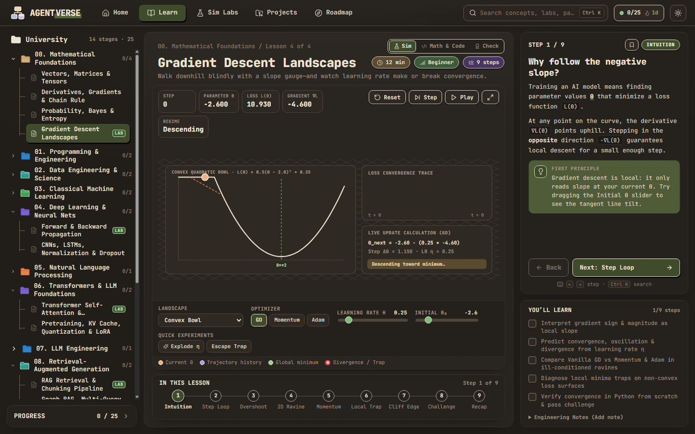
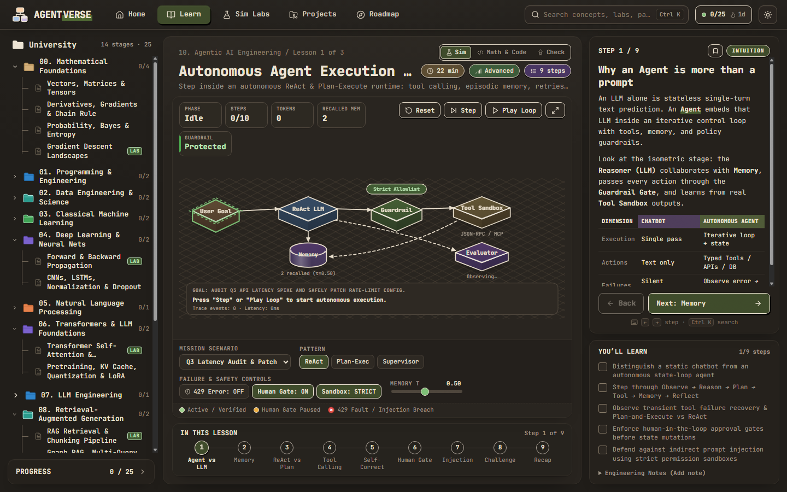
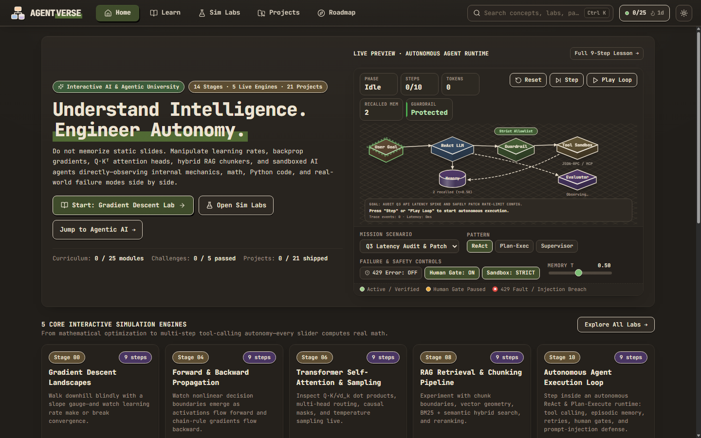
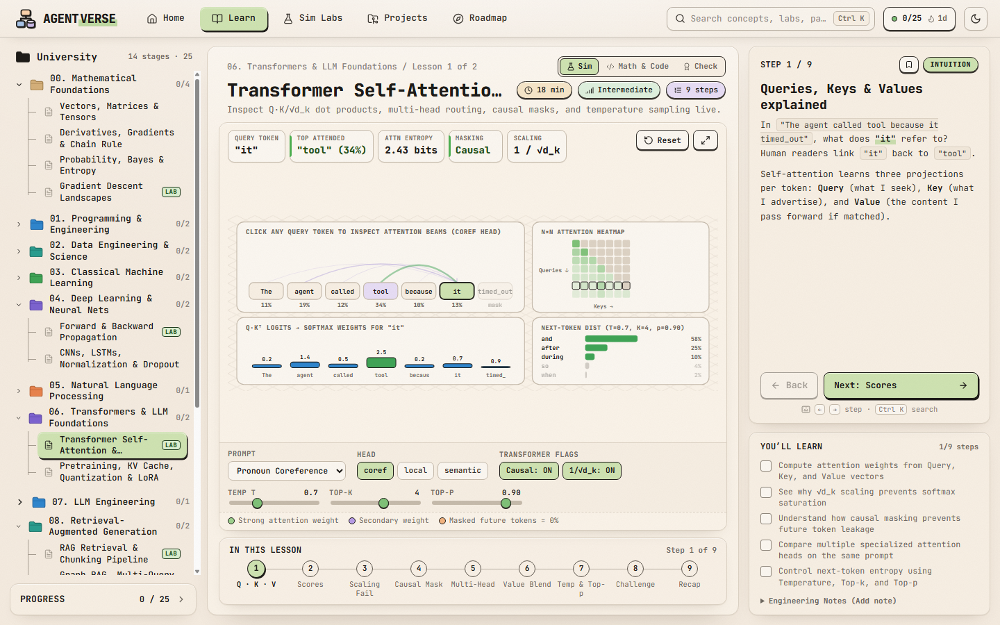

# AGENTVERSE — AGENTIC AI LEARNING TOOL

*Understand Intelligence. Engineer Autonomy.*

An interactive AI, Machine Learning, Transformer, RAG, and Agentic AI Engineering University built around live simulations, first-principles mathematical engines, from-scratch Python implementations, failure-mode analysis, and hands-on engineering challenges.

## Platform Preview

### Interactive Learning Studio — Gradient Descent Landscapes


### Autonomous Agent Execution Loop (ReAct, Guardrails & Memory)


### University Home & Live Agent Preview


### Warm Paper Light Mode — Transformer Self-Attention & Sampling


## Interactive Simulation Engines
1. **Gradient Descent Landscapes (`src/engines/gradientDescent.ts`)** — Convex, Non-Convex Multi-Minima, 2D Ill-Conditioned Ravine contours, and Steep Cliff landscapes comparing Vanilla GD, Momentum, and Adam with stability/divergence detection.
2. **Neural Network Forward & Backward Propagation (`src/engines/neuralNet.ts`)** — Interactive `2 → 3 → 1` MLP with exact forward pass, chain-rule backprop gradients, live `12×12` decision boundaries on XOR/Linear/Circle datasets, and vanishing/exploding gradient diagnostics.
3. **Transformer Self-Attention & Sampling (`src/engines/transformerAttention.ts`)** — Token attention arcs, $N \times N$ heatmaps, $Q \cdot K^\top / \sqrt{d_k}$ scoring, causal masking, multi-head inspection, and Temperature / Top-$k$ / Top-$p$ sampling.
4. **RAG Retrieval & Chunking Pipeline (`src/engines/ragPipeline.ts`)** — Sliding-window chunk boundary analysis, 2D vector space scatter, Cosine vs Euclidean similarity, BM25 + Dense Hybrid retrieval, and Cross-Encoder reranking.
5. **Autonomous Agent Execution Loop (`src/engines/agentRuntime.ts`)** — Deterministic ReAct, Plan-and-Execute, and Supervisor state loop with episodic memory recall, `429` error recovery, Human-in-the-Loop approval gates, and indirect prompt injection sandboxing.

## Curriculum & Engineering Lab
- **14 Stages (00–13):** Complete progressive roadmap from Linear Algebra & Calculus through Production AI Infrastructure and Frontier Research.
- **21 Engineering Projects:** Progressive Beginner → Intermediate → Advanced → Capstone system specifications.
- **Interactive Roadmap & Reference:** Clickable dependency graph, AI engineering cheatsheets, and foundational/frontier paper walkthroughs.

## Local Development
```bash
npm install
npm run dev
```

## Verification
```bash
npm run typecheck
npm test
npm run build
```
